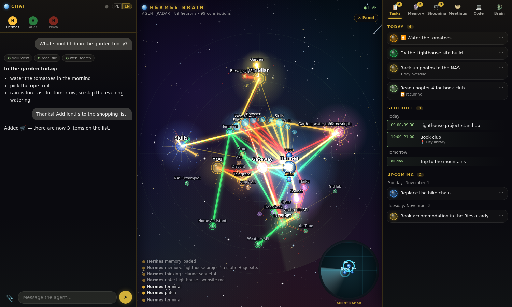

# Hermes Brain

🇵🇱 [Polska wersja](README.pl.md)

A live visualisation of the “brain” of [Hermes](https://github.com/NousResearch) agents: every request, model reasoning step, tool call, skill, memory lookup or Obsidian note lights up a path in a network of neurons. Alongside it: a chat with the agent and a task panel.



*Screenshot taken in demo mode — all data is fictional.*

## Features

- **Neuron network** — channels (Telegram, Discord, CLI, cron, API) → gateway → agents → models, tools, skills, memory, Obsidian vault, external services.
- **Live** — the server reads Hermes `state.db` databases (read-only) and streams events over SSE; paths light up, and frequently used routes become “worn paths” (30 days of history).
- **Agent radar** — who was active and when.
- **Code view** — what the agents recently wrote (`write_file`, `patch`, `terminal`, `execute_code`).
- **Side panel** (optional backend) — chat, tasks, schedule, shopping list, meetings.
- **Privacy** — selected vault folders are shown without note titles; by default the server listens on `127.0.0.1` only.
- **Native window** (`okno/`, Rust + WebKitGTK) — an optional frameless window with an icon and a menu entry.
- **Demo mode** — fictional notes, sessions and skills in `demo/` (Polish) and `demo-en/` (English), so you can see it in action without your own Hermes.

## Requirements

- Python 3.9+ (standard library only)
- a web browser
- optional: Hermes (`~/.hermes`) and an Obsidian vault
- optional, for the window: Rust, GTK 3, WebKitGTK 4.1 (`libwebkit2gtk-4.1-dev`)

## Running

```bash
git clone https://github.com/longer54/hermes-brain.git
cd hermes-brain

# demo (fictional data, nothing else needed)
python3 server/server.py --demo        # or: MOZG_DEMO=1 python3 server/server.py
python3 server/server.py --demo --lang pl   # Polish demo data (default follows system locale)
# → http://127.0.0.1:8110/

# with your own Hermes
cp config.example.json ~/.config/mozg-hermesa/config.json   # then adjust it
python3 server/server.py
```

Native window (optional):

```bash
cd okno && cargo build --release
MOZG_ADRES=http://127.0.0.1:8110 ./target/release/mozg-okno
./target/release/mozg-okno --instaluj   # icon + menu entry
```

## Configuration

Precedence: environment variables > config file > defaults. File: `$MOZG_CONFIG` or `~/.config/mozg-hermesa/config.json` (template: `config.example.json`).

| Key / variable | Default | Description |
|---|---|---|
| `hermes_home` / `MOZG_HERMES_HOME` | `~/.hermes` | Hermes directory (state.db, skills, memories, profiles) |
| `vault` / `MOZG_VAULT` | `~/Obsidian/Vault` | Obsidian vault |
| `host` / `MOZG_HOST` | `127.0.0.1` | listen address |
| `port` / `MOZG_PORT` | `8110` | port |
| `language` / `MOZG_LANG` / `--lang` | `auto` | UI language: `auto` (browser language), `en` or `pl`. Also sets which demo data set is used |
| `backend` / `MOZG_BACKEND` | empty | optional chat/tasks backend (`host:port`); empty = chat and lists disabled |
| `agents` | auto | profile → display name (`""` = main profile) |
| `private_folders` | `[]` | vault folders shown without note titles |
| `services`, `hosts` | examples | service/machine nodes detected by regex in terminal commands |
| `MOZG_DEMO=1` / `--demo` | — | demo mode |
| `MOZG_ADRES` (window) | `http://127.0.0.1:8110` | server address for the native window |

The server opens Hermes databases in read-only mode only. Don't expose it to the internet — it has no authentication.

## Status / Roadmap

The UI is available in English and Polish. Language selection, in order of priority: `?lang=en|pl` in the URL, the PL/EN switch in the UI (remembered in the browser), the `language` config key (`MOZG_LANG`), then the browser language (Polish → `pl`, anything else → `en`). Polish screenshot: `docs/screenshot-pl.png`.

## Disclaimer

A private hobby project, made for learning and personal use. Not affiliated with Anthropic. The software is provided “as is”, without warranty of any kind.

License: [MIT](LICENSE) © longer54
