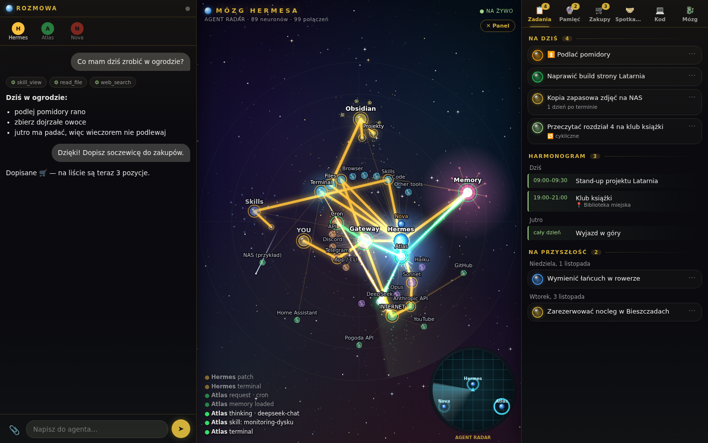

# Mózg Hermesa

🇬🇧 [English version](README.md)

Wizualizacja „mózgu” agentów [Hermes](https://github.com/NousResearch) na żywo: każde zapytanie, myślenie modelu, użycie narzędzia, skilla, pamięci czy notatki z Obsidiana zapala ścieżkę w sieci neuronów. Obok czat z agentem i panel zadań.



*Zrzut z trybu demo — wszystkie dane są zmyślone.*

## Funkcje

- **Sieć neuronów** — kanały (Telegram, Discord, CLI, cron, API) → gateway → agenci → modele, narzędzia, skille, pamięć, vault Obsidiana, usługi zewnętrzne.
- **Na żywo** — serwer czyta (tylko do odczytu) bazy `state.db` Hermesa i strumieniuje zdarzenia przez SSE; ścieżki się podświetlają, a często używane trasy „wydeptują się” (30 dni historii).
- **Radar agentów** — kto był aktywny i kiedy.
- **Podgląd kodu** — co agenci ostatnio pisali (`write_file`, `patch`, `terminal`, `execute_code`).
- **Panel boczny** (opcjonalny backend) — czat, zadania, harmonogram, zakupy, spotkania.
- **Prywatność** — wybrane foldery vaulta pokazywane bez tytułów notatek; serwer domyślnie słucha tylko na `127.0.0.1`.
- **Okno natywne** (`okno/`, Rust + WebKitGTK) — opcjonalne okno bez belki z ikoną i wpisem w menu.
- **Tryb demo** — zmyślone notatki, sesje i skille w `demo/` (PL) i `demo-en/` (EN), żeby zobaczyć działanie bez własnego Hermesa.

## Wymagania

- Python 3.9+ (tylko biblioteka standardowa)
- przeglądarka
- opcjonalnie: Hermes (`~/.hermes`) i vault Obsidiana
- opcjonalnie dla okna: Rust, GTK 3, WebKitGTK 4.1 (`libwebkit2gtk-4.1-dev`)

## Uruchomienie

```bash
git clone https://github.com/longer54/hermes-brain.git
cd hermes-brain

# demo (zmyślone dane, nic nie musisz mieć)
python3 server/server.py --demo        # albo: MOZG_DEMO=1 python3 server/server.py
python3 server/server.py --demo --lang en   # angielskie dane demo (domyślnie wg locale systemu)
# → http://127.0.0.1:8110/

# z własnym Hermesem
cp config.example.json ~/.config/mozg-hermesa/config.json   # i dostosuj
python3 server/server.py
```

Okno natywne (opcjonalnie):

```bash
cd okno && cargo build --release
MOZG_ADRES=http://127.0.0.1:8110 ./target/release/mozg-okno
./target/release/mozg-okno --instaluj   # ikona + wpis w menu
```

## Konfiguracja

Kolejność: zmienne środowiskowe > plik konfiguracyjny > domyślne. Plik: `$MOZG_CONFIG` lub `~/.config/mozg-hermesa/config.json` (wzór: `config.example.json`).

| Klucz / zmienna | Domyślnie | Opis |
|---|---|---|
| `hermes_home` / `MOZG_HERMES_HOME` | `~/.hermes` | katalog Hermesa (state.db, skills, memories, profiles) |
| `vault` / `MOZG_VAULT` | `~/Obsidian/Vault` | vault Obsidiana |
| `host` / `MOZG_HOST` | `127.0.0.1` | adres nasłuchu |
| `port` / `MOZG_PORT` | `8110` | port |
| `language` / `MOZG_LANG` / `--lang` | `auto` | język interfejsu: `auto` (język przeglądarki), `en` lub `pl`; wybiera też zestaw danych demo |
| `backend` / `MOZG_BACKEND` | puste | opcjonalny backend czatu/zadań (`host:port`); puste = czat i listy wyłączone |
| `agents` | auto | profil → nazwa wyświetlana (`""` = profil główny) |
| `private_folders` | `[]` | foldery vaulta bez tytułów notatek |
| `services`, `hosts` | przykłady | węzły usług/maszyn wykrywane regexem w poleceniach terminala |
| `MOZG_DEMO=1` / `--demo` | — | tryb demo |
| `MOZG_ADRES` (okno) | `http://127.0.0.1:8110` | adres serwera dla okna natywnego |

Serwer otwiera bazy Hermesa wyłącznie w trybie tylko-do-odczytu. Nie wystawiaj go do internetu — nie ma uwierzytelniania.

## Stan / plany

Interfejs jest dostępny po angielsku i po polsku. Kolejność wyboru języka: `?lang=en|pl` w adresie, przełącznik PL/EN w UI (zapamiętany w przeglądarce), klucz `language` w configu (`MOZG_LANG`), potem język przeglądarki (polski → `pl`, reszta → `en`). Zrzut po polsku: `docs/screenshot-pl.png`.

## Zastrzeżenia

Prywatny projekt hobbystyczny, tworzony do nauki i własnego użytku. Nie jest powiązany z Anthropic. Oprogramowanie udostępniane „tak jak jest”, bez gwarancji.

Licencja: [MIT](LICENSE) © longer54
